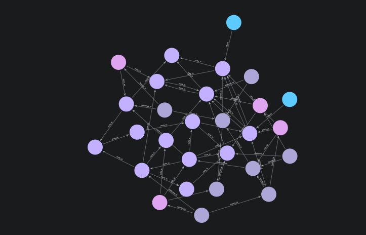

# TALOS: Defense Analytical System


## 1. Problem Statement and Abstract

**Problem.** Military troop movements between checkpoints are planned manually. Simultaneous movements can collide at shared checkpoints or deadlock, and threat information is not factored into route choice.

**Abstract.** TALOS plans safe, collision-free movement of multiple troops between military checkpoints. It uses polyglot persistence: Neo4j models the checkpoint road network, officer hierarchy, troops and threat events; MongoDB stores static soldier, transport and mission records; Redis streams are used by the python to communicate with mongoDB. A Python analytical layer runs time-aware A\* for each troop and Conflict-Based Search (CBS) to resolve collisions, with threat-based penalties added to route cost. A FastAPI service exposes the planner to a Laravel + Livewire dashboard, where commanders submit each troop's start and end checkpoint and receive conflict-free routes with threat warnings.

---

## 2. Team

| Name | Register Number |
|---|---|
| Harish Kumar M V | 25BCE1361 |
| Kaushik M | 25BCE1359 |
| J Cadshel Anten Henry | 25BCE1286 |

---

## 3. Functional Features

1. **Network management:** create, read, update and delete checkpoints and routes.
2. **Personnel and troop management:** officers, troops, escorts, and chain-of-command queries.
3. **Threat registration:** threat events raise the routing cost of affected checkpoints.
4. **Multi-troop conflict-free planning:** time-aware A\* per troop plus CBS to remove collisions.
5. **Unavoidable-threat warning:** if a chokepoint forces a route through a threat, the plan is still returned with a warning flag and per-troop exposure.
6. **Mission logging:** confirmed missions stored in MongoDB.
---

## 4. Technology Stack

| Layer | Technology |
|---|---|
| Graph database (primary) | Neo4j |
| Document database | MongoDB |
| Cache /Interservice communication | Redis |
| Analytical layer | Python (time-aware A\*, custom CBS) |
| Service API | FastAPI |
| Web backend and UI | Laravel (PHP) + Livewire |

**Architecture layers:** Livewire dashboard → Laravel backend → Python/FastAPI analytical service → Neo4j / MongoDB / Redis.

---
## 5. Setup and Run
## AI GENERATED PLEASE CHANGE
### 5.1 Neo4j
1. Create a new local database (Neo4j Desktop or server) and start it.
2. Apply the constraints and indexes: `database/neo4j/` *[file name]*.
3. Load the seed data: `database/neo4j/` *[file name]*.

### 5.2 MongoDB
1. Start MongoDB.
2. Import the sample collections from `database/mongodb/` *[confirm]*.

### 5.3 Redis
1. Start Redis. *[confirm whether reservations are integrated]*

### 5.4 Configure
1. Copy `.env.example` to `.env`.
2. Fill in the Neo4j, MongoDB and Redis connection details.

### 5.5 Run the analytical service
```bash
pip install -r requirements.txt
uvicorn api:app --reload   # [verify module and app names]
```
Interactive API docs are served by FastAPI at `/docs`. All routes are under the `/api` base path.

### 5.6 Run the web app
```bash
composer install
php artisan serve
```
*[add any Livewire / asset build steps]*

---

## 6. Database Description

TALOS uses three NoSQL stores.

### 6.1 Neo4j (graph)

**Nodes**

| Node | Properties |
|---|---|
| `officer` | id, name, rank, rank_val, status |
| `checkpoint` | id, name, status, lat, lng, type |
| `troop` | id, name, status, type, head_count, priority |
| `threatevent` | id, name, type, severity, timestamp |

**Relationships**

| Relationship | Cardinality |
|---|---|
| `(officer)-[:stationed_at]->(checkpoint)` | N:1 |
| `(officer)-[:reports_to]->(officer)` | N:1 (forms a hierarchy tree) |
| `(officer)-[:belongs_to]->(troop)` | N:1 |
| `(troop)-[:escorts]->(officer)` | 1:1 / 1:N |
| `(troop)-[:starts_at]->(checkpoint)` and `[:ends_at]` | N:1 each |
| `(threatevent)-[:affects]->(checkpoint)` | N:1 |
| `(checkpoint)-[:route_to {distance}]->(checkpoint)` | M:N with an attribute |

**Keys and constraints**
- `id` (UUID) identifies every node.
- `checkpoint.name` is unique. 
- `route_to` is directional in storage but queried bidirectionally.

### 6.2 MongoDB (document)
## AI GENERATED PLEASE CHANGE

| Collection | Purpose | Key fields |
|---|---|---|
| `Soldier_Record` | Static soldier / officer attributes | *[confirm]* (references `officer.id`) |
| `Transport_Asset` | Vehicles and cargo for a troop | *[confirm]* (references `troop.id`) |
| `Mission` | Confirmed mission log | *[confirm]* (references troop and checkpoint ids) |

### 6.3 Redis (key-value)
## AI GENERATED PLEASE CHANGE (STALE)

| Entry | Purpose |
|---|---|
| `Slot_Reservation` | Temporary checkpoint-and-timestep reservation held for a troop, with a TTL so stale holds expire *[confirm]* |

### 6.4 Cross-database references
## AI GENERATED PLEASE CHANGE

Relationships across stores are modelled by storing the other entity's id as a foreign-key-style reference (e.g. `Mission.troop_id` → `troop.id`).

### 6.5 Sample data
## AI GENERATED PLEASE CHANGE (HARISH PLEASE UPDATE THIS)
- 8 officers, 14 checkpoints, 4 troops (alpha, bravo, charlie, delta), 2 threat events, about 27 `route_to` roads.
- Checkpoint coordinates use public Tamil Nadu installation locations; all names, records and personnel are synthetic.
- MongoDB and Redis sample counts: *[fill]*.

---

## 7. Core Algorithm (Analytical Layer)

1. Input: for each troop, an id, a start checkpoint and an end checkpoint.
2. Load the checkpoint subgraph, coordinates and threat scores from Neo4j. A threatened checkpoint adds `severity² + 2.5` (summed over its events) to the cost of entering it.
3. **Low level:** time-aware A\* over `(checkpoint, timestep)` states with a haversine heuristic, wait-in-place moves, banned `(checkpoint, timestep)` constraints and a timestep cap.
4. **High level (CBS):** plan every troop independently, find the first same-checkpoint, same-time conflict, branch into two children that each ban one troop from it, and replan only that troop. Expand the cheapest node first, so the first conflict-free node is optimal.
5. Output: per-troop path, cost and threat exposure, plus a warning flag if risk was unavoidable. A search-expansion limit (5000) prevents runaway searches.

---

## 8. Screenshots

### 8.1 Neo4j Graph View




---

### 8.2 API Documentation & CRUD Operations


*Screenshot coming soon.*

---

### 8.3 Single-Troop Route


*Screenshot coming soon.*

---

### 8.4 Multi-Troop Plan with Conflict Resolution


*Screenshot coming soon.*

---

### 8.5 Threat Warning on Unavoidable Risk


*Screenshot coming soon.*

---

### 8.6 Livewire Dashboard


*Screenshot coming soon.*

---

### 8.7 MongoDB Mission Log


*Screenshot coming soon.*

## 9. Known Limitations

- Waiting on a threatened checkpoint adds no extra threat penalty.
- Plans are static and not recomputed from live position updates.
- Heuristic functions and CBS weights are not optimized for peak performance.
- Concurrent mission planning is not possible as of now.

**Future work:** periodic re-planning from live updates, optimizing the CBS tree and weights for better decision performance, rank and mission-priority-aware planning.

---

## 10. Demonstration Video

YouTube: *[add link]*

---

## 11. References
1. Official documentation: Neo4j, MongoDB, Redis, FastAPI, Laravel, Livewire.