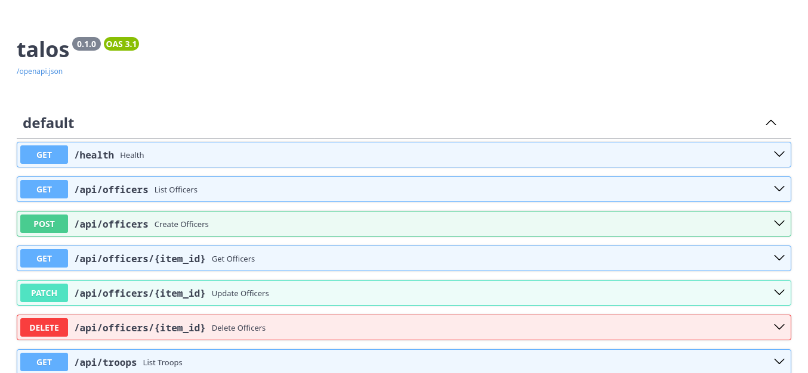
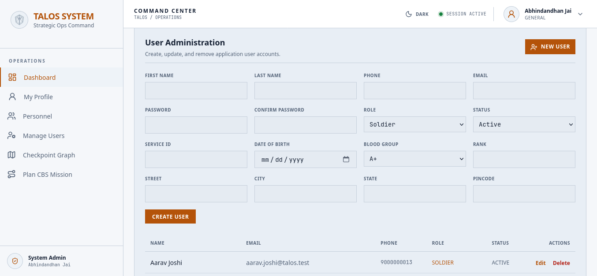
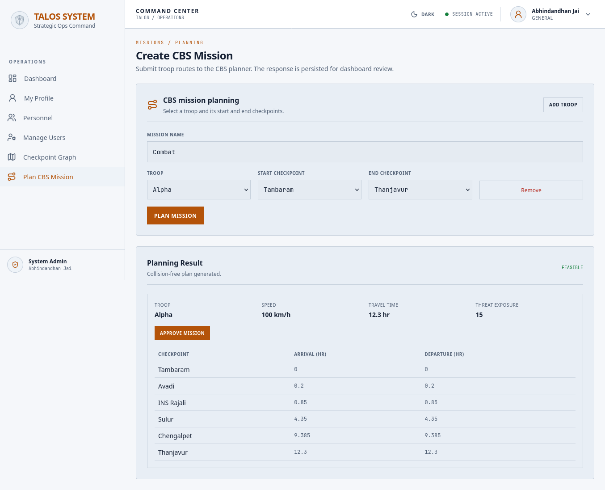
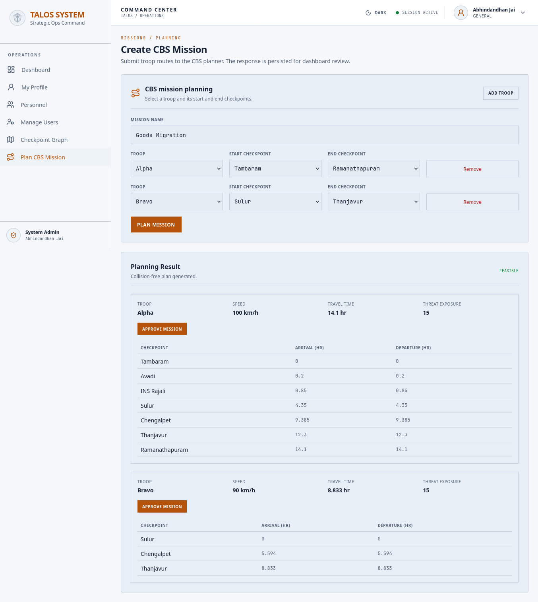
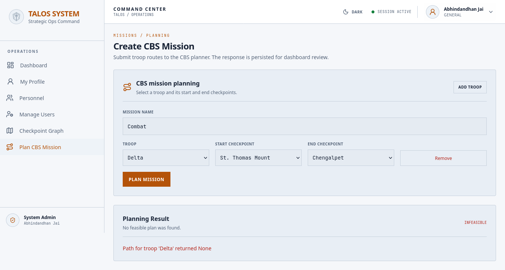
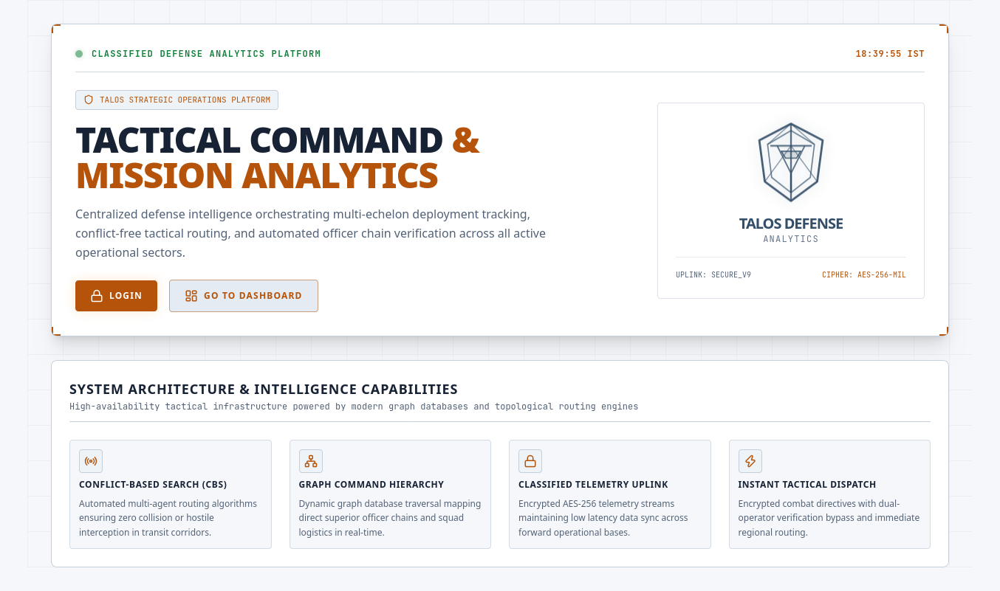
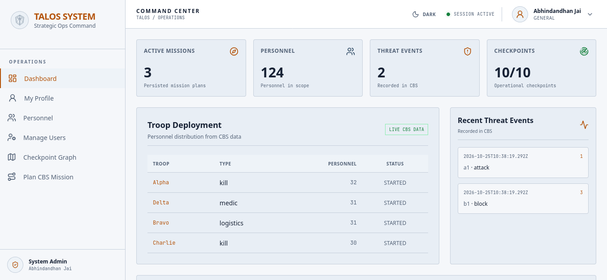
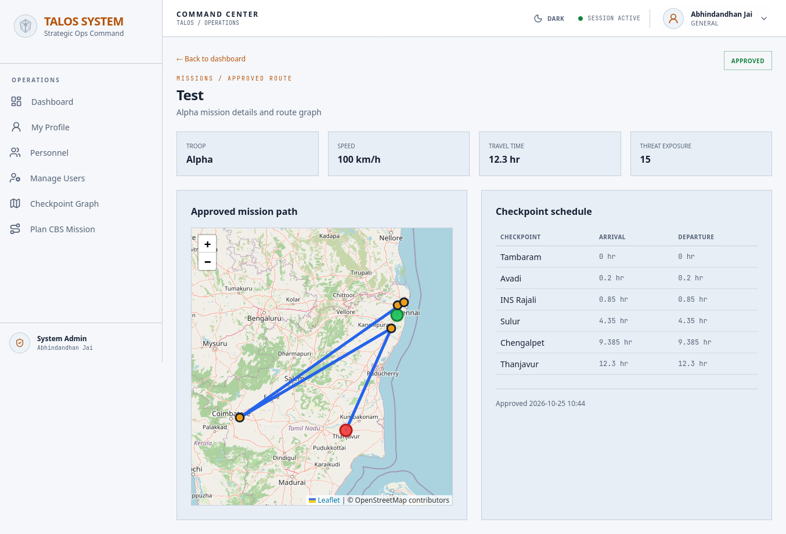

# TALOS: Defense Analytical System

## 1. Problem Statement and Abstract

**Problem.** Military troop movements between checkpoints are planned manually. Simultaneous movements can collide at shared checkpoints or deadlock, and threat information is not factored into route choice.

**Abstract.** TALOS plans safe, collision-free movement of multiple troops between military checkpoints. It uses polyglot persistence: Neo4j models the checkpoint road network, officer hierarchy, troops and threat events; MongoDB stores static soldier, transport and mission records; Redis streams are used by the python to communicate with mongoDB. A Python analytical layer runs time-aware A\* for each troop and Conflict-Based Search (CBS) to resolve collisions, with threat-based penalties added to route cost. A FastAPI service exposes the planner to a Laravel + Livewire dashboard, where commanders submit each troop's start and end checkpoint and receive conflict-free routes with threat warnings.

---

## 2. Team

| Name | Register Number |
|---|---|
| Harish Kumar M V | 25BCE1361 |
| Kaushik M | 25BCE1359 |
| J Cadshel Anten Henry | 25BCE1286 |

---

## 3. Functional Features

1. **Network management:** create, read, update and delete checkpoints and routes.
2. **Personnel and troop management:** officers, troops, escorts, and chain-of-command queries.
3. **Threat registration:** threat events raise the routing cost of affected checkpoints.
4. **Multi-troop conflict-free planning:** time-aware A\* per troop plus CBS to remove collisions.
5. **Unavoidable-threat warning:** if a chokepoint forces a route through a threat, the plan is still returned with a warning flag and per-troop exposure.
6. **Mission logging:** confirmed missions stored in MongoDB.
---

## 4. Technology Stack

| Layer | Technology |
|---|---|
| Graph database (primary) | Neo4j |
| Document database | MongoDB |
| Cache /Interservice communication | Redis |
| Analytical layer | Python (time-aware A\*, custom CBS) |
| Service API | FastAPI |
| Web backend and UI | Laravel (PHP) + Livewire |

**Architecture layers:** Livewire dashboard -> Laravel backend -> Python/FastAPI analytical service -> Neo4j / MongoDB / Redis.

---
## 5. Setup and Run

This project has been containerized and can work with major containerization platforms such as `docker` and
`podman`. To start with, clone the project via:

```
$ git clone https://github.com/kauboi007/Talos.git
$ cd Talos
```

1. Setup your local `.env` file by copying the `.env.example` and then modify the connection details
The `docker-compose.yml` file already sets up all the backend databases for the application.

> [!TIP]
> You can start the DBs beforehand via:
> ```
> $ docker compose up -d neo4j mongo redis
> ```

2. Run the CQL scripts (`talos_neo4j_seeder.cql` then `talos_report_hier.cql`) to seed the basic data for
the Neo4j DB. 

3. Run the migrations for the DB via

```
$ composer run setup
$ php artisan db:seed
```

4. You can start the application via

```
$ docker compose up -d
```

and point to `http://localhost:8000` at your browser to view the application

---

## 6. Database Description

TALOS uses three NoSQL stores.

### 6.1 Neo4j (graph)

**Nodes**

| Node | Properties |
|---|---|
| `officer` | id, service_id |
| `checkpoint` | id, name, status, lat, lng, type |
| `troop` | id, name, status, type, head_count, priority |
| `threatevent` | id, name, type, severity, timestamp |

**Relationships**

| Relationship | Cardinality |
|---|---|
| `(officer)-[:stationed_at]->(checkpoint)` | N:1 |
| `(officer)-[:reports_to]->(officer)` | N:1 (forms a hierarchy tree) |
| `(officer)-[:belongs_to]->(troop)` | N:1 |
| `(troop)-[:escorts]->(officer)` | 1:1 / 1:N |
| `(troop)-[:starts_at]->(checkpoint)` and `[:ends_at]` | N:1 each |
| `(threatevent)-[:affects]->(checkpoint)` | N:1 |
| `(checkpoint)-[:route_to {distance}]->(checkpoint)` | M:N with an attribute |

**Keys and constraints**
- `id` (UUID) identifies every node.
- `checkpoint.name` is unique. 
- `route_to` is directional in storage but queried bidirectionally.

### 6.2 MongoDB (document)

This is used in order to store mostly static (durable) data and logs which doesn't directly correspond to
relations within the graph modelled in neo4j.

| Collection | Purpose | Key fields |
|---|---|---|
| `soldiers` | Static soldier / officer attributes | (referenced via `service_id`) |
| `users` | User attributes for authentication and authorization | (referenced via `service_id`) |
| `transports` | Vehicles and cargo for a troop | (referenced via `vehicle_no`) |
| `missions` | Confirmed mission log | (references troop and checkpoint ids) |

Various other collections (such as `sessions`, `migrations`, etc...) are also created by Laravel
automatically for facilitating the authentication, website functions and Laravel's internal functionality.

### 6.3 Redis (key-value)

Redis is used for the following:
- Primarily to facilitate request-response communication between CBS service in Python and Laravel (done 
via Streams). This architecture is followed so that to allow independent horizontal scaling of python CBS
service irrespective of the web application.
- It is also used by the Laravel Framework itself for its internal functionality (such as caching).

| Entry | Purpose |
|---|---|
| `talos:cbs:requests` | Redis Stream to manage data requests from CBS service to Laravel |
| `talos:cbs:responses` | Redis Stream to manage data responses from Laravel service to CBS |

### 6.4 Cross-database references

Relationships across stores are modelled by storing the other entity's id as a foreign-key-style reference (e.g. `missions.troop_id` → `troop.id`). Referential integrity is validated at application level due to the
polyglot architecture. Hence each service is mapped to a single DB (Laravel -> MongoDB), (Python CBS -> neo4j) and Redis is used as means for message passing between both.

### 6.5 Sample data
- 124 officers, 14 checkpoints, 4 troops (alpha, bravo, charlie, delta), 2 threat events, about 27 `route_to` roads.
- Checkpoint coordinates use public Tamil Nadu installation locations; all names, records and personnel are synthetic.

---

## 7. Core Algorithm (Analytical Layer)

1. Input: for each troop, an id, a start checkpoint and an end checkpoint.
2. Load the checkpoint subgraph, coordinates and threat scores from Neo4j. A threatened checkpoint adds `severity² + 2.5` (summed over its events) to the cost of entering it.
3. **Low level:** time-aware A\* over `(checkpoint, timestep)` states with a haversine heuristic, wait-in-place moves, banned `(checkpoint, timestep)` constraints and a timestep cap.
4. **High level (CBS):** plan every troop independently, find the first same-checkpoint, same-time conflict, branch into two children that each ban one troop from it, and replan only that troop. Expand the cheapest node first, so the first conflict-free node is optimal.
5. Output: per-troop path, cost and threat exposure, plus a warning flag if risk was unavoidable. A search-expansion limit (5000) prevents runaway searches.

---

## 8. Screenshots

### 8.1 Neo4j Graph View


---

### 8.2 API Documentation & CRUD Operations





---

### 8.3 Single-Troop Route



---

### 8.4 Multi-Troop Plan with Conflict Resolution



---

### 8.5 Threat Warning on Unavoidable Risk



---

### 8.6 Livewire Dashboard





---

### 8.7 MongoDB Mission Log



## 9. Known Limitations

- Waiting on a threatened checkpoint adds no extra threat penalty.
- Plans are static and not recomputed from live position updates.
- Heuristic functions and CBS weights are not optimized for peak performance.
- Concurrent mission planning is not possible as of now.

**Future work:** periodic re-planning from live updates, optimizing the CBS tree and weights for better decision performance, rank and mission-priority-aware planning.

---

## 10. Demonstration Video

TODO: Add YT link

---

## 11. References
1. Official documentation: Neo4j, MongoDB, Redis, FastAPI, Laravel, Livewire.
